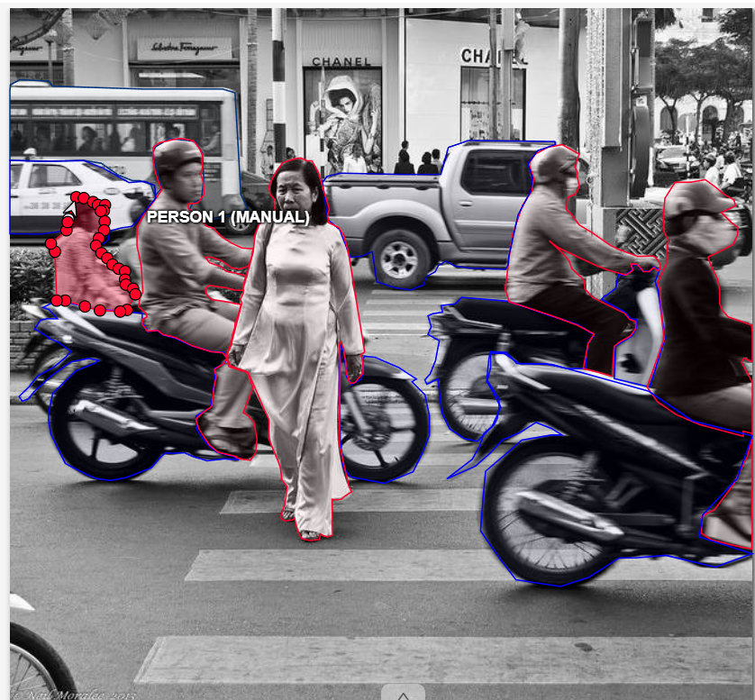

# Báo cáo thực hành Day 3 — điền trực tiếp trong fork của bạn

- Mã học viên theo lớp: 2A202603235 
- Ngày / CVAT local: 12/11/2026
- Công cụ đã dùng: CVAT (Polygon, Brush/Mask, Eraser); GitHub để nộp bài.

## 1. Bài đã nộp

Tôi đã thực hiện gán nhãn 14 ảnh thuộc 9 task trên CVAT. Các annotation đã được vẽ; tại thời điểm viết báo cáo, tôi đã thực hiện bước Save, export và kiểm tra file ZIP trước khi nộp.

| Task | File ZIP đúng tên | Hoàn thành mấy ảnh | Điểm tối đa (coach chấm sau) |
| --- | --- | ---: | ---: |
| easy_semantic | easy_semantic.zip | 3/3 | 20 |
| medium_instance | medium_instance.zip | 3/3 | 32 |
| hard_panoptic | hard_panoptic.zip | 2/2 | 30 |
| cp1_holes | cp1_holes.zip | 1/1 | 3 |
| cp2_slice | cp2_slice.zip | 1/1 | 3 |
| cp5_occlusion | cp5_occlusion.zip | 1/1 | 3 |
| cp3_thin | cp3_thin.zip | 1/1 | 3 |
| cp4_curb | cp4_curb.zip | 1/1 | 3 |
| cp6_coverage | cp6_coverage.zip |1 / 1 | 3 |
| **Tổng tối đa** | | | **100** |

## 2. Một quyết định trước khi dùng gợi ý

- Ảnh, vị trí và object Medium đầu tiên tự vẽ: Tôi chọn "Person" trong ảnh sau  của medium_instance vì nhận thấy đối tượng rõ ràng.
- Class và quy tắc tôi dùng để chọn biên: Tôi xác định class dựa trên loại vật thể trong ảnh, sau đó vẽ mask theo phần thực tế nhìn thấy. Tôi cố gắng bám sát đường viền, không tô lấn sang nền và không gộp các vật thể khác nhau vào cùng một instance.
- Nếu không dùng gợi ý: tôi tự xác định ranh giới bằng Polygon hoặc Brush/Mask, phóng to ảnh để xử lý các vùng khó nhìn.

## 3. Một lỗi tôi tìm thấy và sửa

- Task/ảnh/vùng: Task medium_instance/ảnh 3/vùng đông đúc person đi lại
- Lỗi thuộc loại: sai lớp / thiếu-thừa vật / gộp-tách / biên / phủ vùng / khác: Biên / phủ vùng.
- Bằng chứng tôi nhìn thấy: Trong quá trình gán nhãn, tôi gặp tình huống các vùng tô nằm chồng lên nhau, khiến việc xác định ranh giới giữa các class trở nên khó khăn.
- Quy tắc và hành động sửa: Tôi kiểm tra lại đường biên của từng vùng, sử dụng công cụ chỉnh sửa polygon để loại bỏ phần lấn thừa và tránh chồng lấn không đúng giữa các object.
- Sau sửa đã Save và export lại chưa? : Đã sửa, Save và export lại.

Kết quả tự đánh giá: Chưa có điểm từ GitHub Actions. Tôi chưa sử dụng Ground Truth để đối chiếu bài làm.

## 4. Ba ca chưa chắc hoặc đã cân nhắc

Mỗi ca là một **vùng cụ thể** khiến bạn phải cân nhắc hai cách hiểu. Ghi dấu hiệu nhìn thấy hoặc quy tắc đã dùng, rồi nêu quyết định hoặc câu hỏi cho coach. Không cần ba lỗi; ca đã quyết định được cũng hợp lệ.

| Ảnh/vị trí | Hai cách hiểu có thể | Quy tắc/chứng cứ | Quyết định hoặc câu hỏi cho coach |
| --- | --- | --- | --- |
| 1. medium_instance — Xe van chở hàng (cargo van) | Gán car vì có hình dạng giống ô tô, hoặc truck vì dùng để vận chuyển hàng hóa. | Guideline chưa quy định rõ xe van chở hàng thuộc class nào. | Tôi chưa chắc nên chọn car hay truck, cần coach xác nhận để gán nhãn nhất quán. |
| 2. cp1_holes — Khoảng trống ở bánh xe và khung xe máy | Tô toàn bộ vùng bên trong đường viền bánh xe, hoặc chỉ tô các bộ phận thật sự thuộc xe và để trống những khe hở. | Có thể nhìn thấy nền phía sau qua các nan hoa bánh xe và khoảng trống giữa các bộ phận. | Tôi chọn chỉ gán phần xe máy thực sự nhìn thấy, không tô kín các lỗ trống và không gộp giá đỡ bánh sau vào xe máy. |
| 3. cp4_curb — Ranh giới giữa mặt đường và vỉa hè | tô phần bó vỉa cùng road, hoặc cùng sidewalk khi không có class curb riêng. | Hai vùng nằm sát nhau, có đoạn màu sắc tương tự nên khó xác định đường biên. | Tôi ưu tiên xác định ranh giới dựa trên cấu trúc mặt đường và vỉa hè thay vì chỉ dựa vào màu sắc. Phần bó vỉa chưa có class riêng cần coach xác nhận quy tắc gán. |
